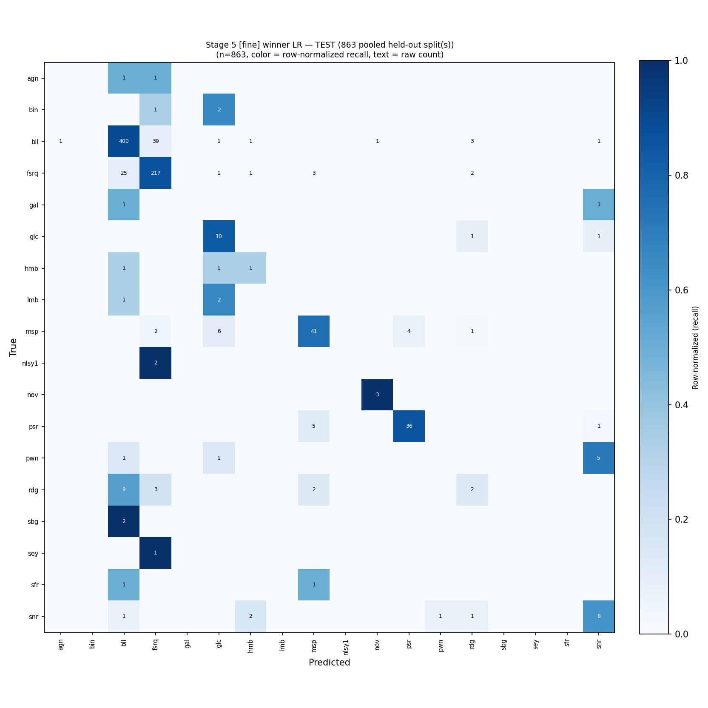
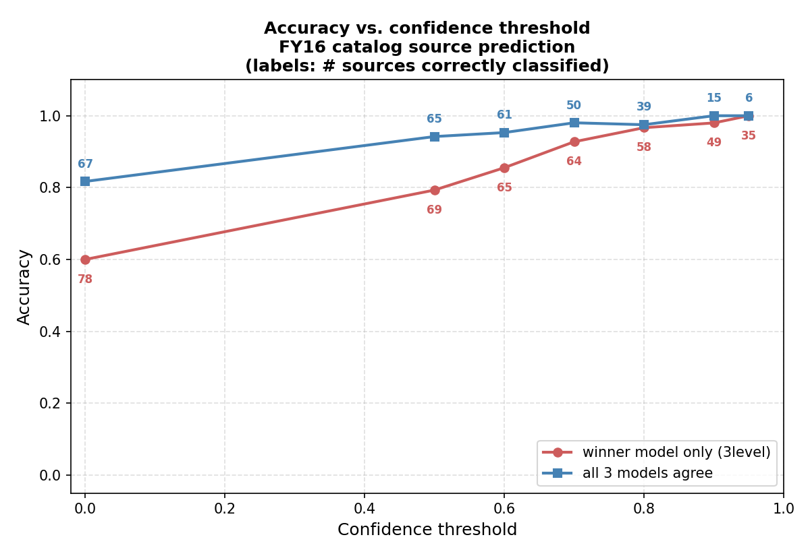

# Results

These are the results of the final run: profile `reduced`, model selection on macro-F1, one 70/30
split. All numbers come from
[`outputs_4FGL_DR4_macro_f1_final_single_split/validation/csv_reports/`](outputs_4FGL_DR4_macro_f1_final_single_split/validation/csv_reports/).
The [README](README.md) describes the pipeline and the three model families.

## Setup

| Item | Value |
|---|---|
| Labeled set (Setup B) | 2,876 associated 4FGL-DR4 sources in 18 classes. Blazars of uncertain type (`bcu`) and `spp` sources are excluded. The classes are very imbalanced: 1,490 `bll` against 4 `sey`. |
| Split | One stratified 70/30 split with seed 42. Feature selection, model search and model selection use only the 2,013 training sources, with 5-fold stratified cross-validation. The 863 test sources are scored once, after selection is finished. |
| Selection metric | Macro-F1. It weights every class equally and, unlike balanced accuracy, penalizes false positives. An earlier run that selected on balanced accuracy learned to send hundreds of `bll` and `fsrq` sources into rare classes. |
| Confidence intervals | Stratified bootstrap over the test rows, for accuracy, macro-F1 and κ. They cover the sampling of test rows only. With a single split, they do not include variation between splits. |

## Main result

| Family | Deployed model | CV macro-F1 | Test macro-F1 [95% CI] | Test accuracy | Test balanced accuracy | Test κ |
|---|---|---|---|---|---|---|
| fine | Logistic regression | 0.291 | 0.319 [0.287, 0.354] | 0.832 | 0.349 | 0.737 |
| merged | RF router; RF, LR, LDA and CatBoost branches | 0.284 | 0.329 [0.268, 0.373] | 0.819 | 0.322 | 0.714 |
| 3level | MLP gate, MLP sub-gate, CatBoost router; per-branch models | 0.295 | 0.309 [0.270, 0.346] | 0.829 | 0.320 | 0.727 |

The macro-F1 intervals of the three families overlap almost entirely, so none of them is better than
the others. The hierarchical designs do not beat a flat logistic regression on this data. On the
training side, the Borda ranking picked 3level as the best family, and it is not better on the test
set.

Accuracy is high and macro-F1 is low because macro-F1 counts each of the 18 classes equally. The two
large blazar classes and the pulsars are classified well. Most of the rare classes are not, as the
next section shows.

*Fine model on the 863 test sources. Colour shows recall within each true class, and the numbers are
counts. Most errors are between `bll` and `fsrq` (39 and 25 sources). Radio galaxies (`rdg`) are
mostly classified as `bll`.*

## Results per class

Test F1 per class. `n` is the number of test sources in the class.

| Class | n | fine | merged | 3level |
|---|---|---|---|---|
| bll | 447 | 0.90 | 0.89 | 0.89 |
| fsrq | 249 | 0.84 | 0.81 | 0.82 |
| msp | 54 | 0.77 | 0.71 | 0.76 |
| psr | 42 | 0.88 | 0.80 | 0.89 |
| rdg | 16 | 0.15 | 0.00 | 0.00 |
| snr | 13 | 0.53 | 0.77 | 0.71 |
| glc | 12 | 0.56 | 0.38 | 0.38 |
| pwn | 7 | 0.00 | 0.67 | 0.62 |
| hmb | 3 | 0.25 | 0.40 | 0.50 |
| nov | 3 | 0.86 | 0.00 | 0.00 |
| lmb | 3 | 0.00 | 0.50 | 0.00 |
| bin | 3 | 0.00 | 0.00 | 0.00 |
| agn, gal, nlsy1, sfr, sbg | 2 each | 0.00 | 0.00 | 0.00 |
| sey | 1 | 0.00 | 0.00 | 0.00 |

In every family, F1 is between 0.71 and 0.90 for the four large classes (`bll`, `fsrq`, `msp`,
`psr`). The hierarchies do better on supernova remnants and pulsar wind nebulae (`snr`, `pwn`) and
worse on globular clusters and novae (`glc`, `nov`). For a class with one to three test sources, each
source moves F1 by a large step, so the lower half of the table says little about any family.

`rare_class_shrinkage_*.csv` contains a shrinkage analysis of the rare classes (empirical-Bayes
partial pooling of per-class recall). It is only reported and is never used to select models.

## Calibration

| Model | Brier score | Expected calibration error |
|---|---|---|
| fine, raw | 0.285 | 0.128 |
| fine, temperature-scaled | 0.254 | 0.043 |
| merged, raw | 0.276 | 0.060 |
| 3level, raw | 0.247 | 0.023 |

The raw flat logistic regression is underconfident: on average its accuracy is 0.13 higher than the
confidence it reports, because the class weighting moves probability toward the rare classes. The
calibrated version undoes that weighting and then applies a single temperature, chosen on the
out-of-fold log-loss, which brings the gap down to 0.04. The merged model is mildly underconfident
(0.06) and the 3level model is close to calibrated without any scaling. The reliability tables are in
`calibration_reliability_*.csv`.

## Covariate shift

Unassociated sources are fainter than associated ones and more often lie in the Galactic plane, so
the test set does not represent the sources the predictions are made for. The table gives the fine
model's test metrics by stratum.

| Stratum | n | Accuracy | Macro-F1 |
|---|---|---|---|
| All test sources | 863 | 0.832 | 0.319 |
| \|b\| < 10° | 127 | 0.732 | 0.439 |
| \|b\| ≥ 10° | 736 | 0.849 | 0.241 |
| Signif_Avg < 4.9 | 39 | 0.590 | 0.307 |
| Signif_Avg 4.9 to 6.8 | 115 | 0.748 | 0.247 |
| Signif_Avg ≥ 6.8 | 709 | 0.859 | 0.317 |
| Reweighted to the unassociated population | about 50 (effective) | 0.430 | 0.180 |

Reweighted to resemble the unassociated sources, accuracy falls from 0.83 to about 0.43, and all
three families land between 0.43 and 0.46. The effective sample size of this estimate is only about
50, so the number is rough. The direction is clear, though: predictions for unassociated sources are
much less reliable than the test results above suggest. Source: `shift_aware_test_metrics.csv`.

## Check against a later catalog

The deployed models predicted classes for the 2,563 sources that are unassociated in DR4. A later
release of the catalog (`gll_psc_v41`) has since associated some of them, which gives a small test set
the models could not have seen. Sources whose new class is `bcu`, `spp` or still `unk` are excluded.

| Subset | Sources with a new class | Accuracy [95% CI] |
|---|---|---|
| 3level alone, all predictions | 130 | 0.60 [0.51, 0.69] |
| 3level alone, confidence ≥ 0.8 | 60 | 0.97 [0.89, 1.00] |
| All three families agree (1,211 of 2,563 sources) | 82 | 0.82 [0.72, 0.89] |
| All three agree, each with confidence ≥ 0.7 | 51 | 0.98 [0.90, 1.00] |

Agreement between the families and the model's own confidence both separate good predictions from
bad ones. When the three families agree and are confident, the prediction is almost always right. The
sources that the later catalog managed to associate need not be representative of the rest, so these
accuracies do not carry over to all unassociated sources. The per-source cross-match is in
`v41_crossmatch_per_source_3level.csv`.

## Caveats

1. There is one split. The intervals come from bootstrapping the 863 test rows and do not show how
   much the results would move with a different split.
2. The balanced-accuracy intervals use the Beta-posterior method of Brodersen et al. (2010), which
   shrinks the recall of each class toward 0.5. With many rare classes near zero recall, the posterior
   sits above the plain estimate, and an interval can exclude it. For example, the balanced accuracy
   of the subset where all three families agree is 0.31, with an interval of 0.33 to 0.58. These
   intervals are left out of the tables above; the CSV files contain them.
3. The `reduced` search space was narrowed with the cross-validation leaderboards of an earlier full
   search, which used a different partition. Some rows that informed the narrowing are therefore in
   this test set. The choice was coarse (which model families to keep) and based only on
   cross-validation scores, so the effect should be small. It is still a researcher degree of freedom;
   see section A6.9 of
   [docs/scientific_review_with_citations.md](docs/scientific_review_with_citations.md).
4. Ten of the 18 classes have three or fewer test sources. Their per-class numbers are too noisy to
   count as estimates.

## Other result files

Paths are relative to `validation/csv_reports/` unless noted.

| File | Contents |
|---|---|
| `train_validation_test_metric_comparison_with_ci.csv` | Training, cross-validation and test metrics with intervals, per family |
| `winner_full_report.csv` | Full set of metrics for each deployed model |
| `per_class_metrics_*.csv`, `per_class_recall_ci_*.csv` | Per-class precision, recall and F1 |
| `all_models_validated_*.csv`, `per_node_leaderboards/` | Every validated candidate, and the leaderboard of each node |
| `confidence_threshold_summary_*.csv`, `high_confidence_predictions_*.csv` | Predictions for unassociated sources, by confidence |
| `cross_family_prediction_agreement.csv` | The three families' predictions for each unassociated source, with disagreements flagged |
| `../results/predictions_unknown_sources_*.csv` | Class probabilities for every unassociated source |
| `analysis/` (next to `validation/`) | Plots: feature importance, distributions, calibration, power curves |
